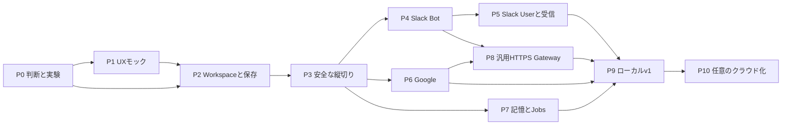

# 実装ロードマップ — Workspace分離型パーソナルBotプラットフォーム

**2026-10-15 / r2：domain別Drizzle・Repository層なし / アプリは未実装**

## 0. 結論と参照基準

**「Web UIのモック → Workspaceを通した保存 → 隔離・鍵・承認の縦切り → Slack → Google → 記憶・自律実行 → 汎用HTTPS Gateway → 配布・復旧」**の順で進める。

最初からすべての機能を実装チケットに分解しない。最終到達点は共有するが、詳細な仕様とチケットは直近1マイルストーンだけ作る。特に認証・sandbox・バイナリ配布の不確実性は、UI本実装の前に小さい実験で潰す。

### 調査で確認したこと

NanoClawの確認コミットは `f2934abaf2d89f5b95b19ac1809a0ddc1eda1f79`。OneCLI連携は `.claude/skills/add-onecli/versions.json` で **Gateway 1.42.0 / CLI 2.2.5 / SDK 2.2.1** を個別に固定している。NanoClaw側の説明では、Gateway 1.43以降は使用中のsecret-assignment APIがなくなり、そのまま対応しない。最新版OneCLIのREADMEを「NanoClawが使うv1の仕様」として読まない。[S01–S04](SOURCES.md#nanoclaw--onecli)

NanoClawはGatewayだけでなく、ホスト側のルーティング、セッション、承認フロー、スケジュール、コンテナなどを持つ。置き換えるのは「OneCLIの画面」だけではない。[S01–S04](SOURCES.md#nanoclaw--onecli)

この計画は**ユーザーが指定した中核機能の同等性**を目標とする。NanoClawの全チャネル、全provider、専用Slackアプリの自動発行、OneCLIの全ベンダー・全商用機能を無条件に初版へ含める意味ではない。P0で参照機能一覧を固定する。

## 1. 推奨アーキテクチャ

### 1.1 実行境界

```text
                    macOS：信頼する領域
┌─────────────────────────────────────────────────────────┐
│ apps/web：ブラウザUI（必要なら後でTauriの殻からも利用）     │
│   │ same-origin HTTP + SSE                               │
│   ▼                                                      │
│ apps/backend：Bun / TypeScript                            │
│   認証済みユーザー、Workspace、会話、Bot、Job、Run          │
│   app.db / scoped memory / artifacts                     │
│   │ 管理IPC                         │ Runner lifecycle   │
│   ▼                                 ▼                    │
│ apps/securityd：Rust              隔離agent-runnerを起動    │
│   Vault / OAuth / Grant / Policy / Approval / Audit        │
│   security.db + OS Keychain                               │
│   vendor adapters / model proxy / HTTPS MITM              │
└───────────────────▲─────────────────────────────────────┘
                    │ 制限された実行APIのみ
       ┌────────────┴──────────────────────┐
       │ Bot/Conversation単位のsandbox      │
       │ apps/agent-runner：TypeScript      │
       │ Claude Agent SDK + CLI subprocess │
       │ 自分用のsession/artifact mounts    │
       │ 外部ベンダーtoken・管理APIはなし    │
       └───────────────────────────────────┘
                    securityd → Slack / Google / Anthropic
```

ここでの信頼境界は「同じプロセス内のクラス分割」ではなく、OS/コンテナ・ファイル・ネットワークの制限を伴う。Agent SDKの権限フックは補助であり、sandboxの代わりにしない。[S11](SOURCES.md#agent-sdk--runtime)

**脅威モデルの限界:** ホストOS、ログイン中の所有者、backend、securityd、コンテナ基盤は信頼する。これら全体が侵害された場合まで鍵やWorkspaceを守れるとはしない。会社の機密について必要な隔離強度がこの前提を超える場合、別OSアカウント/VM/端末などをP0で選び直す。

### 1.2 なぜBunとRustをこう分けるか

| 担当 | 推奨 | 理由・境界 |
|---|---|---|
| Web、会話、Bot管理、ジョブ、API、CLI | TypeScript / Bun | UIとdomainの変更を一貫して扱う。I/O中心の制御を二言語に重複実装しない |
| Claude Agent SDK adapter | TypeScript | 固定要件。隔離プロセス内でSDKと実行物を管理 |
| Vault、token交換・refresh、Gateway、認可の最終判定 | Rust | 秘密を扱う実行経路を一つに閉じる。OS連携・HTTP/TLS処理を独立した実行物にまとめる |
| domainの型・IPC | バージョン付きschema | wire schemaは一つを正本にしTS/Rust側を生成・検証。手書きで二重管理しない |
| 高速化が必要な処理 | 計測後に選択 | 「Rustだから速い」だけで会話やCRUDまで移さない |

Rustを選ぶこと自体は安全性の証明ではない。初版は**一つのbackend＋一つのsecurityd＋必要なagent-runner**。Vault・policy・OAuthをそれぞれ別マイクロサービスにしない。securitydは深いモジュール境界を持つ一つのプロセスとする。

`securityd`に汎用 `getSecret()` や任意のtokenを返すAPIは作らない。公開するのは接続開始・接続メタデータ・権限管理・要求された操作の実行・結果の取得。OAuthのtoken endpointはagent用Gatewayから到達させない。

### 1.3 DBはSQLite＋ローカルファイル

SQLiteはローカルな単一アプリサーバー用途に適する。D1はマネージドDB、R2はオブジェクトストレージであり、同じ役割ではない。[S14–S16](SOURCES.md#storage)

**設計提案:** 初版では `app.db` はbackendだけ、`security.db` はsecuritydだけが書く。前者に会話・Run・記憶、後者に資格情報・Grant・Policy・Approval・実行台帳を置く。メッセージ添付等はWorkspace別ディレクトリへ。BotにはこれらのDBを直接mountしない。

**固定するコード配置:** DBを所有する各 `packages/<domain>` がDrizzle schema・migrationを持つ。TypeScriptのdomain関数がDrizzleで直接読み書きし、Repository層や共通CRUD wrapperは挟まない。domain別migrationは物理DBの分割を意味しない。生成・適用の詳細は1.5節。

DB間に分散トランザクションを持ち込まない。securitydのApproval/Operationが正本であり、UI表示用の状態はイベントから再構築する。コマンドID・イベントID・outbox/inbox・再照合で不整合を回復する。

**D1を最初にしない理由は性能の断定ではなく配置の整合性。** ローカルの鍵、永続ディレクトリ、長時間のAgent SDK subprocessを使うのに、最初からデータだけクラウドに置くと、オフライン・権限・整合性・通信障害の設計が増える。クラウド化が必要になった時点でP10を独立プロジェクトとして扱う。

Vaultの暗号化は会話DBや添付まで自動的に暗号化するわけではない。初版の会話・記憶はOSのディスク保護＋ファイル権限を前提とし、アプリ単位の暗号化が会社用途に必要かP0で決める。バックアップは暗号化する。

### 1.4 推奨リポジトリ形状

以下は成長後の配置案。P2から全ディレクトリを空で作らず、実装のある境界だけ追加する。

```text
<repo>/
├── apps/
│   ├── backend/          # Bun: HTTP/SSE、domain wiring、DB接続・migration適用の取りまとめ
│   ├── web/              # React等のWeb UI。状態の正本はbackend
│   ├── agent-runner/     # TS Agent SDK、sandbox内entrypoint
│   ├── securityd/        # Rust binary entrypoint、cratesを組み立てるだけ
│   ├── cli/              # 人用管理CLI / agent用限定clientは権限を分離
│   └── desktop/          # 任意。後でTauri shellを追加
├── packages/
│   ├── workspace/        # Workspace/Bot/Conversation、Drizzle schema・migration・操作
│   ├── agent/            # Run/Session/Job、Drizzle schema・migration、SDK adapter境界
│   ├── memory/           # 記憶・検索、Drizzle schema・migration・操作
│   ├── connections/      # 非機密projection・UIモデル、Drizzle schema・migration・操作
│   ├── security/         # security.dbのDrizzle schema・migration（開発/build用）
│   ├── contracts/        # 生成wire types、schema、protocol version。DBは所有しない
│   └── ui/               # 共通コンポーネント。DBは所有しない
├── crates/
│   ├── security-core/    # identity、Grant、policy、承認・operation状態機械
│   ├── vault/            # 鍵保管、暗号化、rotation、unlock
│   └── gateway/          # OAuth/HTTP vendor adapters、model proxy、MITM
├── docs/
│   ├── planning/         # この一式。ROADMAPは全体の索引
│   ├── agents/           # tracker設定などsetup skillの出力
│   └── adr/              # 維持する設計判断だけ
├── GLOSSARY.md
├── CLAUDE.md             # 既存ファイルを尊重。別の指示ファイルを乱立させない
├── Cargo.toml            # apps/securitydとcratesをworkspace membersにする
└── package.json          # Bun workspace、検査/build entrypoints
```

小さい間は `workspace` 内のdomain moduleで十分。別package化はimport境界・再利用・独立テストが実際に必要になった時に行う。サードパーティvendorのHTTP変換・資格情報処理はRust側を正本とし、TS側に同じpolicyを実装しない。

### 1.5 domainがDrizzleとmigrationを所有する

**ユーザー指定の方針:** `packages/<domain>` はDBから切り離した純粋domain層ではなく、その機能の振る舞いと永続化をまとめたpackageにする。Repository interface、Repository実装、汎用CRUD service、将来のDB交換だけを目的とするstorage adapterは作らない。

DBを所有するTypeScript domainの配置例:

```text
packages/memory/
├── src/
│   ├── schema.ts          # このdomainが所有するDrizzle table/index/constraint
│   ├── operations.ts      # 認可・業務処理からDrizzleを直接使用
│   └── index.ts           # 公開する操作。service classの作成は必須でない
├── drizzle/               # このdomainの生成SQLとsnapshot/metadata
├── drizzle.config.ts      # schema/outをこのdomainへ向ける
└── package.json

apps/backend/src/
├── db.ts                  # app.dbを開き、具体的なDrizzle接続を組み立てる
└── migrate.ts             # domain migrationの適用を取りまとめる入口
```

ファイル名は例であり、`operations.ts`が大きくなれば操作名のファイルへ分ける。DBを持たない `ui` や `contracts` に空のschema/migrationを作らない。

**呼出し経路:** `apps/backend → packages/<domain>の操作関数 → Drizzle → app.db`。domain関数には必要に応じて具体的なDrizzleのDB/transactionと、信頼側で確定したTenantContextを渡す。抽象Repositoryを引数にする構造へ戻さない。型の共有が本当に必要になった場合だけ、接続・具体的な型を薄く共通化する。packageからappsをimportしない。

原則として各domainが自分のtableの更新とmigrationを所有する。他domainの操作との調整には公開関数を使い、同一 `app.db` 内で原子性が必要なら同じtransactionを渡す。読み取りのJOINまで一律禁止して無駄な抽象化を増やさないが、依存方向とWorkspace条件は明示する。SQL・認可処理・DB接続をWeb bundleやagent-runnerへ持ち込まない。

#### migrationの「置き場所」と「適用管理」は分ける

Drizzle Kitはschemaの参照先とSQL/snapshotの出力先、および複数configを指定できる。生成したSQLを外部の仕組みで適用する選択肢もある。[S17–S19](SOURCES.md#s17--drizzle-config)

ここでは各domainのschemaと履歴をそのpackageに置いたまま、DB所有アプリの一つの入口から適用を取りまとめる。以下はこの製品の設計条件であり、Drizzleが自動で全て実現するという意味ではない。

- 各tableのDDLを変更するdomainは一つ。生成対象に他domainのtableを無制限に含めず、生成SQLに他domainのDROP/CREATEが紛れないか検査する。cross-domain FKを生成する方法と依存順序もP2で実証する。
- 同じDBに対するmigration適用は直列化する。独立したmigration履歴を無区別に同じ履歴として扱わず、domain別の識別と依存関係を保持する。履歴tableの分離など採用driver/versionの標準機能を優先し、不足する取りまとめだけをアプリ側で補う。
- 単なるpackage名順ではなく、必要な参照先のmigrationが先に適用されるようにする。適用済みSQLは書き換えず、修正は追加migrationにする。
- 通常運用はレビュー済みSQLの適用。domainの一部schemaだけを対象にした `push` を本番共有DBへ実行しない。
- 最初のP2の縦切りに、空DB作成・既存DB更新・再実行・domain間の履歴取り違え防止を含める。複雑な汎用migration frameworkを先に作らない。

**Rustとの境界は変更しない。** `security.db` のschema・Drizzle migrationは `packages/security` が開発/build時の正本として持つ。review済み生成SQLをRust buildへ渡し、実機での適用と実行時のSQL操作はsecuritydだけが行う。RustでDrizzle ORMを動かす設計ではない。Rust側に別の手書きDDL履歴を作らず、TS側も同じDBを直接開かない。接続・承認UI向けprojectionは `packages/connections` の `app.db` tableであり、securitydの正本とは区別する。

このSQL受け渡し・snapshotとの整合・履歴管理は独自のbuild/配布設計なので、P3で検証する。鍵を含まないschema定義をTS側に置くことと、資格情報をTS実行環境へ渡すことを混同しない。

## 2. 最初に決めるdomain model

| 概念 | 定義 |
|---|---|
| Workspace | 個人/会社Aを分ける内部の所有・権限・データ境界。Slack workspaceとは別 |
| Bot | 一つのWorkspaceに所属する永続人格。指示、tool設定、記憶を持つ |
| Conversation | Botを参加させる会話の器。主担当Bot＋参加者を持つ |
| Session | 一つのConversationで一つのBotが継続するモデルセッション |
| Run | メッセージやJobに起因する一回の実行。状態、予算、cancellationを持つ |
| Connection | 外部アカウント/installationと資格情報への参照。内部Workspaceに所属 |
| Credential kind | Slack bot / Slack userなど実際に誰として操作するか |
| Grant | BotがそのConnectionのどの操作・リソースを使えるか |
| ConnectionRequest | Botから人への「接続/追加権限が必要」という要求 |
| Policy / Approval | 常設規則 / 特定リクエストに対する期限付きの判断 |
| Operation | Gatewayが管理する一回の外部操作。承認・送信・結果不明も記録 |
| Memory item | Botの長期記憶。出典・scope・公開範囲・version・削除状態を持つ |
| Channel binding | 外部チャネルを内部Workspace/Conversation/Botへ結びつける設定 |

`Session`の自然なscopeは `(workspace_id, conversation_id, bot_id, provider)`。同じBotを二つの会話に入れても、会話履歴そのものは一つに結合しない。Botを別Workspaceへ移動する機能は初版で禁止し、明示的な新規作成・選択的インポートとする。

Connectionの候補キーには内部Workspace、provider、外部team/account、credential kind、installation/subjectを含める。UIには `internal_workspace_name`、`external_team_name`、`acting_as` を別表示する。同じGoogleアカウントを二つの内部Workspaceで接続しても、Grantと記憶を共有しない。

## 3. OneCLI相当の機能を作る順番

### 3.1 型付きGatewayを先に作り、MITMへ広げる

**P3–P6: 型付き操作 + model reverse proxy**

```text
Bot → execute(calendar.listEvents, connectionRef, arguments)
    → identity検証 → Grant/policy → 必要ならApproval
    → Vaultから内部でtoken利用 → Google API → 安全な結果
```

Botが見るのは操作と結果だけ。これは初期の安全な縦切りを作るための入口であり、最終的なHTTPS Gatewayの代替完了扱いにしない。

**P8: 汎用HTTP transport + 同じ認可系**

```text
Bot内curl/SDK → CONNECT/TLS終端 → HTTP要求を正規化
             → 型付き操作と共通の認可・承認・実行台帳
             → 資格情報注入 → 外部API
```

HTTPSの中身を変更して資格情報を注入するにはTLS終端とsandbox内のCA信頼設定が必要。環境変数を無視して直結するプログラムも想定し、外側から通信を閉じる。[S11](SOURCES.md#agent-sdk--runtime)

**transportが汎用でも、操作権限が無制限という意味にはしない。** 既知providerのoperation catalog、method/path/body解析、宛先・引数制約に従う。未知API、未対応batch、曖昧な本文、未知content-typeは拒否する。任意SDKとの100%互換を先に約束しない。互換対象と拒否対象を明示する。

### 3.2 三つの承認を混ぜない

```text
Bot: 「会社のSlackへ投稿する接続が必要」
  ↓ ConnectionRequest（provider / 操作 / 理由。tokenや任意OAuth URLではない）
人: 接続先Workspace・アカウントを選ぶ
  ↓ provider OAuth同意 → Connection作成
人: このBotにこのchannelへの投稿権限を付与
  ↓ Grant作成（接続しただけでは実行できない）
Bot: 実際の投稿を要求
  ↓ Policyがallow / deny / require_approvalを判断
人: 主体・宛先・本文を確認し今回だけ承認
  ↓ Approval消費、現在のGrant/失効状態を再確認して送信
```

接続カード・承認カードはLLMが生成したHTMLをそのまま表示するものではない。backend/securitydの構造化データをWebが描画する。OAuth URLも登録済みprovider設定から信頼側が生成する。

### 3.3 Vault / Gatewayの最低設計

Workspace別の暗号鍵をOS Keychainで保護する案を基本に、AEAD等の既存実装を使う。`workspace_id`・connection・versionを暗号化の関連データと結びつける。master keyをDB横・`.env`・バイナリ内に置かない。unlock・rotation・復旧・失効・ログの秘匿を含めて一機能とする。

agentに渡してよいのは短命で失効可能な**実行用capability**。これはvendor tokenではないが、操作権限を持つ秘密なのでログや他Botへ漏らさない。callerはこれを使い自分の実行contextを証明し、workspace/botを任意に上書きできない。

Vaultだけでなく、許可されている送信先、HTTP redirect、ホスト名/DNS、HTTP body、ログ、返却データからの秘密反射まで扱う。詳細は [SECURITY-ACCEPTANCE.md](SECURITY-ACCEPTANCE.md)。

## 4. 接続ごとの実装方針

### Slack: 二つのidentityとOAuthの制約

SlackのOAuthではbotの `scope` とuserの `user_scope` が分かれ、bot tokenと `authed_user` 内のuser tokenも別扱いになる。[S20](SOURCES.md#slack)

**重要:** 現行Slack docsでは、PKCEのdesktop redirect（custom URI、PKCE有効時のlocalhost）からbot scopesを要求できない。したがって「Bunバイナリにdesktop PKCEを載せればBot/User両方が一つの経路で済む」とは設計しない。[S21](SOURCES.md#slack)

初版の推奨は**自分用Slack Appのserver OAuth**。client secretは所有者が安全な設定画面で登録してVaultに保存し、コードや配布物へ埋め込まない。登録済みHTTPS callbackだけをローカルsecuritydに届ける経路をP0で検証する。必要な公開callback/tunnelはWeb管理API全体の公開と分離し、one-time stateで保護する。クラウドDBは不要だが、外から到達できるcallback経路には信頼上のコストがある。

User-onlyのdesktop PKCEを別構成で提供する選択肢も残す。PKCE設定は元に戻しづらい変更なので既存Appに無断で切り替えない。完全オフライン設置の簡易導入は手動token登録を用意できるが、Botがtoken入力を求めるチャットにしてはいけない。**手動登録だけをOAuth対応の完了扱いにはしない。**

初期APIは接続検査、許可channelの履歴/情報、明示channelへの投稿。User Tokenの必要性は実際に選ぶAPIのtoken対応表で判断し、User権限を要求しすぎない。`xoxb`/`xoxp`等のprefixだけでidentityを決めず、OAuth応答と検証済みmetadataを正本にする。

外部Slackからの受信もNanoClaw中核機能としてP5に入れる。ローカル構成ではSocket Modeが候補だが、これはBot/User tokenとは別のapp-level tokenを必要とする。受信処理は信頼側で動かす。将来Marketplace配布する際はSocket Modeの配布制約も再確認する。[S22–S24](SOURCES.md#slack)

### Google: CalendarとGmailを段階的に

ローカル初版はGoogleのDesktop OAuth client、外部ブラウザ、loopback callback、PKCEを基本案とする。Web配布へ移る場合は別のOAuth client/redirect設計が必要。[S25](SOURCES.md#google)

実装順は **Calendar読み取り → 予定作成承認 → Gmail読み取り → メール送信承認**。一つのGoogle認証を使えても、CalendarのGrantがGmail利用の許可になる設計にはしない。scope追加時の同意・付与を明示する。

Gmailの読み取りscopeはrestrictedに分類されるものがあるため、個人利用・会社内利用・他者配布のどの形で使うか、審査/検証の該当性をP0で調べる。Google OAuthのExternal/Testingでは対象scopeによってrefresh tokenが7日で期限切れになる。この環境で「1週間後に壊れるのは実装バグ」と誤認しない。[S26–S28](SOURCES.md#google)

Gmail最低操作はmessage一覧/本文、send。Calendar最低操作はcalendar選択、events一覧、event作成。メールのCC/BCC/添付、予定のattendees/sendUpdates/timeZoneは承認対象に含める。削除・広範囲modify・delegateは初版の必須としない。

**接続解除とprovider側のrevokeは別操作。** まずBotのGrantを停止し、ローカルConnectionを無効化する。外部revokeは同一user/clientの他の接続へ影響し得るので、影響範囲を表示して実行する。[S25–S26](SOURCES.md#google)

## 5. マイルストーン一覧

各Pはリリース可能なまとまり。チケットはさらに小さい縦切りにする。期間見積もりではなく、依存関係と通過条件を示す。

| ID | 到達点 | 依存 | 主な判定 |
|---|---|---|---|
| P0 | 参照範囲・脅威モデル・実行/認証の実験 | なし | 実測が必要な境界を特定し、失敗時の代案まで判断できる |
| P1 | Grok Bot風Web UXの捨てるモック | P0の基本用語。技術調査と並行可 | Workspace切替から接続・承認まで触って評価できる |
| P2 | Workspace/Bot/会話を永続化する最初の製品 | P0のdomain判断、P1の評価 | 偽応答でも端から端まで保存・分離できる |
| P3 | 実Claude＋sandbox＋自作securitydの安全な縦切り | P2、P0の実行実験 | 鍵非露出、Grantなし拒否、承認→模擬API実行 |
| P4 | Slack Bot接続と操作 | P3、P0のSlack認証判断 | Botの接続依頼→OAuth→Grant→承認投稿 |
| P5 | Slack User＋Slackからの受信 | P4 | 主体切替、token rotation、受信routing、混線なし |
| P6 | Calendar＋Gmail接続 | P3、P0のGoogle認証判断 | 各read/writeを別々に実証。P4/P5との並行は可能 |
| P7 | 永続記憶・グループ・定期実行 | P3。実サービスdemoはP5/P6 | 会話を越える記憶、複数Bot、休止/復旧したJob |
| P8 | CONNECT/TLS終端型のGateway | P3、P4/P6のoperation catalog | curl等でも同じ権限・承認。直接通信は失敗 |
| P9 | ローカルv1完成・復旧・バイナリ配布 | P1–P8 | clean-machineで主要シナリオと攻撃/障害試験が通る |
| P10 | 任意: 遠隔Web、複数人、D1/R2等 | P9 | 別の脅威モデル・データ配置として設計し直す |



### P0 — 設計地図と高リスク実験

**作るもの:** 参照機能matrix、短い脅威モデル、用語、採用判断。技術実験は本番コードへ直接昇格させない。

最初に次の問いを実際のdecision ticketとして切る。

| 決定の名前 | 解く問い | 種類 |
|---|---|---|
| 初版の同等性と対象外 | NanoClawのどこまでを初版に含むか。専用Slack App自動発行は必要か | grilling |
| Webとローカル実行の境界 | localhostで開始するか、最初から遠隔操作必須か | grilling |
| Workspaceと会話の公開範囲 | 会社用の分離強度、同じBotの別会話の記憶共有、複数Botの参加 | grilling/prototype |
| BunとSDKの配布単位 | 選定SDK版をBunから起動・stream・cancel・resumeし、helper assetsを同梱できるか | research＋検証task |
| macOSのsandbox通信 | Docker VM境界を越えてGatewayだけへ通信させられるか。host UDSを仮定しない | research＋検証task |
| Slack Bot/UserのOAuth方式 | desktop PKCE制約を満たすapp/callback/secret配置は何か | research |
| GoogleのOAuth・利用形態 | Desktop clientと必要scopes、Testing/配布/会社承認の制約 | research |
| Gatewayの初期互換範囲 | 型付きbrokerからMITMへ共通化できるrequest/approvalモデルは何か | grilling |
| domain別Drizzleの適用方式 | 各packageのschema・migration配置を維持して、共有app.dbの履歴・依存順・FKをどう検証するか。securitydへ生成SQLをどう渡すか | research＋検証task |

Agent SDKはCLI subprocessを起動し、現行docsでは多くのinstallでnative CLI binaryが同梱される。**Bunの `--compile` だけでSDKの実行依存物まですべて単一バイナリ化できるとはしない。** 選定バージョン、native assets、実行パス、sandboxのOS/architectureを検証する。TS SDKのBun上での動作とコンパイル配布はこの調査では実行していない。[S10–S13](SOURCES.md#agent-sdk--runtime)

**P0 gate:** 未検証事項を消したことにせず、採用/代案/未解決の区別がある。sandbox境界を作れない場合に実tokenを導入しない。

### P1 — 捨てるWebモック

左にWorkspace切替とBot一覧、中央に会話、右または会話内に接続/承認カードという案を起点に、2案程度を比較する。厳密な見た目は未決でよい。

モックで触る流れ: Bot追加 → 会話作成 → 偽の返答 → 接続依頼 → 接続アカウント選択 → Grant → 投稿の一回承認 → 失効/拒否/結果不明。Workspaceを切り替えると別のBot・会話・接続になる。

`/prototype`はUI/状態の問いに使う。in-memoryで、実OAuth・鍵・実APIは持たせない。本実装用のテストやセキュリティを要求してprototypeの目的を混ぜない。[S08](SOURCES.md#mattpocock-skills)

**P1 gate:** 自分で触り、接続同意と操作承認の違い、Slack acting identityが誤解なく読める。採用した判断だけを仕様へ移す。

### P2 — 永続Workspaceと会話のtracer bullet

fake agentでよいので `Web → backend → SQLite → response stream → 再読込` を通す。Workspace作成、Bot作成、Conversation作成、メッセージ保存、Bot設定を実装する。backendがrun lifecycleの正本になる。

各domain内にDrizzle schema・migration・操作関数を置き、Repository層は作らない。最初のWorkspaceの縦切りでDB接続とmigrationの取りまとめを最小構成で通し、memory等を追加する際にdomainごとの履歴分離・依存順を検証する。DBだけの独立大規模チケットにはしない。

基礎のmemory record（明示的なメモの保存/表示/削除）もここで入れる。検索や自動抽出はP7。各record・cache・SSE購読・artifactにWorkspace/Bot scopeを持たせる。

**P2 gate:** 2 Workspace・2 Bot・2会話のfixtureで、ID差替え、購読、検索候補、添付アクセスが混ざらない。再起動後も保存状態が戻る。各domainのmigrationから空DBを作り、旧DBを更新できる。同名/逆順のmigrationでも履歴を取り違えず、再実行で重複DDLが起きない。

### P3 — 最初の安全な実通信

Rust securitydにVault、短命run identity、Grant、三値policy、Approval、実行台帳を作る。同時にsandbox内のTS Agent SDKから実Claudeへの一本を通す。Anthropic credentialもVault/注入経路に置く。

security.dbは `packages/security` のDrizzle schemaから生成したSQLをRust側で適用し、RustのSQL操作との整合性を試験する。Bunからsecurity.dbを書いたり、同じtable用の別DDL履歴をRust側へ手書きしたりしない。

次に、自分で用意した模擬vendorのread/write endpointを使う。Botが操作要求 → Webへ承認 → 模擬vendorに認証付きで一度到達 → 結果がBotへ戻る。模擬vendorが受け取った認証値をそのままログ・返却しない検査も行う。

**P3 gate:** sandboxからenv/ファイル/プロセス引数/ログを検査して実tokenなし。別Workspaceのconnection使用拒否。Grantゼロ拒否。承認後body改変拒否。Gateway停止時は通信失敗。UIを閉じても承認待ちが消えない。

ここは `/implement` で一枚ずつ進める。認可の正本、schema、実行identityの変更を複数agentへ同時に任せない。

### P4 — Slack Botの最初の実用経路

接続依頼カードからserver OAuth、Bot token保管、接続検査、許可channel選択、read、投稿承認まで通す。人がテスト用Slack workspaceにAppを準備する操作は手順化する。OAuth・権限を架空のモック結果で成功扱いしない。

**P4 gate:** 発行された実team/app/bot identityを確認して表示。要求時に指定したteam名を信用しない。refresh競合を抑制し、失効時は再接続状態になる。承認済みchannel以外への投稿を拒否できる。

### P5 — Slack Userと受信channel

User credentialを別主体として登録し、同じBotから「Slack Appとして」「ユーザー本人として」を明示して使えるようにする。Bot tokenで失敗した要求をUser tokenで救済しない。

信頼側のSocket Mode receiverを追加し、外部event → 検証済みinstallation → Channel binding → 内部Conversationの順にroutingする。重複event、再接続、bot自身の投稿への反応ループを制御する。scope不足は安全に通知する。[S22–S24](SOURCES.md#slack)

**P5 gate:** 同じAPI/同じchannelでもBot/UserでGrantが独立。token rotationを別管理。自分の投稿がBotの無限自己会話を誘発しない。別teamの受信が別Workspaceへ流れない。

### P6 — Google CalendarとGmail

OAuthを共通化してもoperationとGrantは別。必要なscopeを段階的に追加する。Calendar read/writeが一度動いてからGmail read/sendへ進める。実アカウント試験は自分のテスト予定表・自分宛メールで行う。

**P6 gate:** callback state差替え・scope拒否・refresh失効を扱える。別Googleアカウント・別Workspaceを選び間違えない。メール/予定の最終内容を承認に固定し、更新後に再承認が必要になる。添付/CC/BCC/attendeesも判定対象。

### P7 — 記憶・グループ・継続的なBot

P2の記憶基盤を発展させる。最初は明示メモ＋会話要約＋全文検索でよく、vector DBや自動dreamは後で計測して選ぶ。記憶ごとにsource、workspace、bot、audience、version、created/updated、tombstoneを持つ。

記憶の正本はSQLite、`CLAUDE.md`等は必要に応じて生成するprojectionとする。逆にファイルを正本にしたい場合も可能だが、双方向に同じ情報を書いて二つの正本を作らない。忘却は検索index・session summary・cache・生成projectionにも波及させ、バックアップ保持の限界も表示する。

グループ会話はまず明示mention/選択されたBotだけを起動し、複数Botが無限に呼び合う自律討論はデフォルト無効。各Botは自分のSessionを持ち、共有するのはそのConversationの公開messageである。private memoryをgroup向け出力へ転用する際のaudience制限を設計する。

Jobはtimezone、期限、missed-run方針、lease、予算、同時実行制限、停止を持つ。日次通知と承認待ちを両立させ、実行時に現在のGrantを再評価する。UIを閉じてもJobの管理が続く。

Botテンプレートと許可されたSKILL/tool設定の複製は追加するが、token・会話履歴・他Workspaceの記憶を複製しない。Botがホスト側のskills/plugin・Gatewayコードを自動変更できる機能は入れない。

**P7 gate:** Bot固有記憶が次Sessionへ反映される。別Bot/Workspaceへの検索漏れゼロ。予定時刻/再起動/停止/失効の挙動が決定的。Bot間ループと予算超過を停止できる。

### P8 — HTTPS Gatewayの同等性を満たす

CONNECT/TLS終端、sandbox限定CA、host/method/path/body正規化、認証header置換、redirect/DNS/SSRF対策、streaming、rate limit、auditを同じOperation経路へつなぐ。型付きツールとHTTP経由で許可結果が一致することをcontract testにする。

CA秘密鍵はsecurityd側のみ。CA trustをホスト全体へ無断installしない。上流TLS証明書を検証し、証明書pinning等で動かないclientは非対応として説明する。HTTP/2等の対応は選ぶライブラリとclientで検証し、未対応protocolを素通ししない。

raw HTTPの承認待ちは無期限の接続維持ではなく、durable operation IDと状態取得/制限付き再試行で扱う。再試行しても同じ承認済み操作が重複実行されない設計にする。既存CLIのerror handlingとの互換性は個別試験する。

**P8 gate:** curlと選定したSDKで成功、環境変数を消した直結は失敗。未知host、IP literal、IPv6、DNS再束縛、redirect、body parser不一致、別connection選択などの拒否を実証。秘密が返却payload・エラー・traceへ漏れない。

### P9 — 配布、復旧、ローカルv1完成

Bun backend/CLIとRust securitydをbuildする。agent-runnerとSDK/native CLIの必要物はsandbox image等の検証済み配布単位に含める。**単一ファイル配布**と**依存物込みで再現可能に起動する配布**を混同しない。macOS artifactとLinux container artifactも区別する。

launch/stop/health/doctor、必要ならlaunchd、migration、互換protocol、暗号化backup/restore、ログ秘匿、監査の保持、鍵更新、失効時のkill switchを仕上げる。署名/notarization・更新方式は対象の配布形態で検証する。Tauriは任意の殻であり、Web UI完成の前提条件にしない。

**P9 gate:** 開発環境のnode_modulesやPATHに依存せず、新規環境で起動する。壊したDB/中断migration/再起動/鍵ロック/外部応答喪失から回復できる。初版完成シナリオと [SECURITY-ACCEPTANCE.md](SECURITY-ACCEPTANCE.md) の必須項目を通す。

### P10 — 必要になってから遠隔/クラウド

スマホから使うだけなら、まずアクセス制御付き接続でローカルbackendへ到達する案を評価する。公開Web originからlocalhostへ直接秘密APIを呼ぶ設計は避ける。

複数端末同期・複数人SaaS・常時クラウド稼働が必要なら、identity、runner leasing、鍵の保管者、D1のtransaction/limit、R2のACL、同期/競合、監査、会社境界を再設計する。D1/R2は任意の配置先であり、Drizzle driverを差し替えるだけの軽微作業とは扱わない。この将来変更のためにRepository層を先回りで導入しない。

## 6. チケット化の粒度と並行実装

悪い分け方は「DB全部」「API全部」「UI全部」。良い分け方は「Workspaceを追加すると一覧に現れ、再起動後も残り、別Workspaceから読めない」のように利用者の挙動が一つ通る分け方。`/to-tickets`もこの縦切りを求める。[S07](SOURCES.md#mattpocock-skills)

### P2のチケット候補 — 実trackerへまだ登録していない

| 名前 | 成果 | blocker候補 |
|---|---|---|
| Workspaceを作成し切り替える | UI/API/保存/権限検査を通す | なし |
| 選択WorkspaceにBotを作る | Bot設定を保存し、他WorkspaceへID差替えできない | Workspace作成 |
| Botの会話を開きfake応答を受ける | message保存、SSE、run stateを確認 | Bot作成 |
| Botのメモを保存・表示・削除する | scope付き記憶の最小経路 | Bot作成 |
| 会話を再読込・再起動して続ける | stream cursorと永続履歴を整合させる | fake応答 |

### P3のチケット候補

| 名前 | 成果 | blocker候補 |
|---|---|---|
| 鍵を安全に登録して接続状態だけを表示する | securitydにfake credential保存、UIに非機密metadataのみ | P2、vault設計判断 |
| 隔離BotからClaudeの返答を得る | scoped runner＋model proxy＋Vaultを通る | 鍵登録、P0実験 |
| Grant付きBotだけが模擬サービスを読める | Gatewayのidentity/認可を実HTTPで検証 | 隔離Bot |
| Botの書き込みをカードで承認し実行する | Approval/Operation/UI/外部効果まで通る | 模擬read |
| 承認待ちを再起動後に再表示する | backendとsecuritydの状態を再照合する | 承認実行 |
| 送信結果不明を再送せず照合する | side effect発生後の応答喪失を故障注入で再現 | 承認実行 |

これは分解の見本であり、最終スコープ・blockerは実コードを読んで決める。共有wire schema/identity/policy engine、同一domainのmigration履歴、domain間に依存するDDL変更は直列化する。独立domainのschema・migrationは別々に作業できても、同じDBへの適用と統合試験は直列化する。契約が固まった後の独立provider、UI view、テストfixtureは並行可能。

`/implement-spec`には**固まった小さなspecとそのticket graph**を渡す。ROADMAP全体を一気に渡さない。初期は同時2程度から始め、merge競合・レビュー負担を見て増やす。PR数やagent数を進捗指標にせず、通過したシナリオと拒否テストを数える。

## 7. 文書を腐らせない運用

全体の到達点はこのROADMAP、要件の入口はBRIEF、現在の判断と実装状態の正本は設定済みtrackerとする。ROADMAPに全ticket本文や全research結果を転記しない。

wayfinderは判断の地図、実装ticketは実装の地図として分ける。調査・prototypeの詳細は作業branch/context pointerに残し、mainへは決定理由と維持する仕様だけを移す。trackerをlocal Markdownにする場合、正式ticketと捨てる調査の場所・commit方針をsetup時に区別する。

各Pを閉じるときに、仕様との差分、検証証拠、残るリスク、実際のsource/runtime versionを記録する。調査資料が古くなったら既存メモを無条件に正本として扱わず、外部仕様を確認する。ADRは判断の変更時にsupersedeし、同じ現行判断を複数箇所へ書かない。
